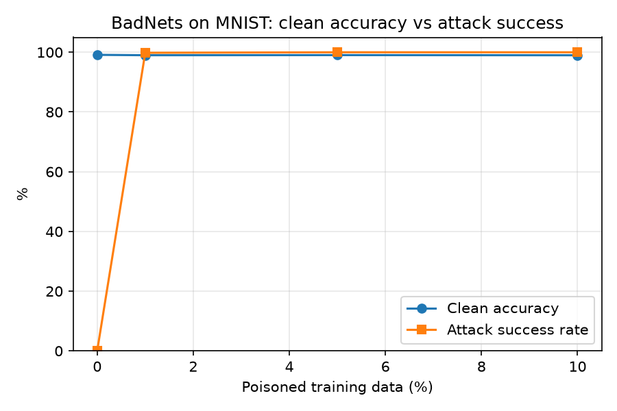
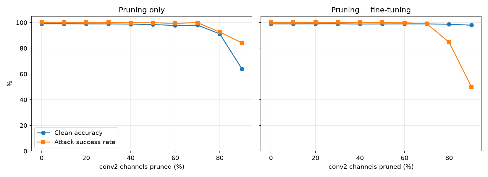
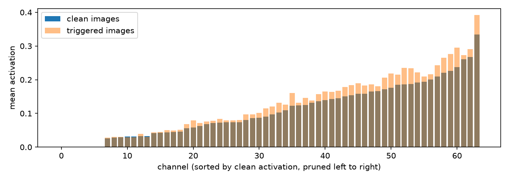

# ml-backdoor-security-lab

Experiments on training-data backdoors in image classifiers: a BadNets-style poisoning attack on MNIST, and an evaluation of fine-pruning as a defense.

The attack part reproduces a known result. The defense part looks at where fine-pruning fails in this setting and why.

## Questions

1. How much poisoned training data does it take to plant a reliable backdoor, and does it show up in clean test accuracy?
2. Can fine-pruning remove the backdoor from a trained model without retraining from scratch?

## Setup

| | |
|---|---|
| Dataset | MNIST (60k train, 10k test) |
| Model | Small CNN: 2 conv + pool blocks, 2 fully connected layers (~422k parameters) |
| Training | Adam, lr 1e-3, batch 128, 5 epochs, seed 42 |
| Trigger | 3×3 white patch near the bottom-right corner |
| Target class | 0 |
| Hardware | RTX 4080 |

**Threat model.** The attacker can modify a small fraction of the training set (images and labels) but has no access to the model, training code or hyperparameters. The defender has the trained model and 5,000 clean training images, and does not know the trigger or target class.

**Metrics.**
- *Clean accuracy*: accuracy on the unmodified test set.
- *Attack success rate (ASR)*: share of triggered test images whose true label is not 0 (9,020 images) that the model classifies as 0.

## Results

### Baseline (`01_baseline.ipynb`)

Clean test accuracy: **98.89%**.

### Attack (`02_badnets_poisoning.ipynb`)

| Poison rate | Poisoned images | Clean accuracy | ASR |
|---|---|---|---|
| 0% (control) | 0 | 99.14% | 0.04% |
| 1% | 600 | 99.01% | 99.82% |
| 5% | 3,000 | 99.05% | 100.00% |
| 10% | 6,000 | 99.00% | 100.00% |



Poisoning 1% of the training set is enough for a near-perfect backdoor. Clean accuracy changes by at most 0.14 points, so testing on clean data alone would not reveal it. The control run shows the trigger has no effect on a clean model (4 of 9,020 images predicted as 0).

### Defense (`03_defense.ipynb`)

Fine-pruning (Liu et al., 2018): rank the 64 channels of the last conv layer by mean activation on clean data, prune the least active ones, then fine-tune for 3 epochs on the defender's 5,000 clean images. Applied to the 10%-poisoned model.

| Channels pruned | Pruning only: clean / ASR | Pruning + fine-tuning: clean / ASR |
|---|---|---|
| 0% | 99.00% / 100.00% | 98.93% / 99.99% |
| 50% | 98.38% / 99.83% | 98.88% / 99.98% |
| 70% | 97.96% / 99.92% | 98.91% / 99.05% |
| 80% | 91.18% / 92.54% | 98.67% / 84.66% |
| 90% | 63.78% / 84.18% | 97.90% / 50.06% |



Fine-pruning only partly worked. The best setting (90% pruned, then fine-tuned) cut ASR to about 50% while keeping 97.90% clean accuracy. Pruning alone and fine-tuning alone had almost no effect.

**Why it fails here.** Fine-pruning assumes the backdoor lives in channels that clean inputs rarely activate. In this model it is the opposite. The five channels most excited by the trigger rank 52, 53, 59, 60 and 63 of 64 in the pruning order, so they are among the most active on clean digits and are pruned last. The seven fully dormant channels have nothing to do with the trigger. A bright, high-contrast patch is close to the stroke and edge features the model already uses for digits, so the backdoor appears to reuse those channels rather than separate ones.



## Limitations

- One seed per setting, so small differences (a few tenths of a percent) are not meaningful.
- MNIST with a visible, fixed patch is the easiest case for the attacker.
- Dirty-label attack: the attacker changes labels as well as images.
- Only `conv2` was pruned, with one fine-tuning setting, on the 10% model only.
- The channel diagnostic uses triggered images, which a real defender would not have.

## Next steps

- Repeat the main results with 3 or more seeds.
- Test poison rates below 1% to find where the attack stops working.
- Test whether a fainter trigger moves the backdoor into low-activation channels, which would make fine-pruning more effective.
- Prune `fc1` as well, and try defenses that inspect the training data instead (activation clustering, spectral signatures).
- Move to CIFAR-10.

## Running

```bash
python3 -m venv .venv
source .venv/bin/activate
python -m pip install torch torchvision matplotlib jupyterlab
jupyter lab
```

Run the notebooks in `notebooks/` in order. 01 downloads MNIST, 02 trains the poisoned models and saves the 10% model that 03 uses. Results are written to `results/`.

Tested with Python 3.14 and PyTorch 2.14.1 (CUDA).

## References

- T. Gu, B. Dolan-Gavitt, S. Garg. *BadNets: Identifying Vulnerabilities in the Machine Learning Model Supply Chain.* 2017.
- K. Liu, B. Dolan-Gavitt, S. Garg. *Fine-Pruning: Defending Against Backdooring Attacks on Deep Neural Networks.* RAID 2018.
